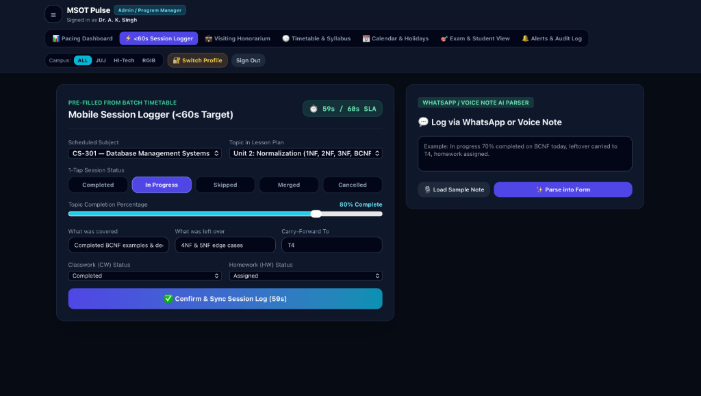

# MSOT Pulse v2.0 — Live Course Progression & Early-Warning Platform (Problem 3)

Built for the **MSOT Course Progression Challenge (Problem 3)**. Tracks syllabus delivery across **HI-Tech, RGIB, and JUJ** for both the **Mirai Track** and **University Track** with 2-decimal mathematical parity, automatic timetable hour derivation, calendar-walking date shifts, strict RBAC faculty isolation, and `<60s` mobile faculty session logging.



## 📋 Submission Checklist Included in This Repo
- [x] **One-Command Setup:** `docker-compose.yml` + `Dockerfile` + `schema.sql`
- [x] **Architecture & Design Doc:** See [`DESIGN_DOC.md`](./DESIGN_DOC.md)
- [x] **Mandatory Test Report & Load Test Results:** See [`TEST_REPORT.md`](./TEST_REPORT.md) & [`tests/loadtest.js`](./tests/loadtest.js)
- [x] **4-Campus Sample Semester Dataset:** See [`data/sample_semester_4_campuses.csv`](./data/sample_semester_4_campuses.csv)

## 🚀 One-Command Local Setup (Docker)
```bash
docker compose up --build
```
Then open **`http://localhost:5173`**.

## ⚡ Fast Local Development (Node / Vite)
```bash
npm install
npm run dev
```
Open the local URL printed by Vite in the terminal (usually `http://localhost:5173`).

To create a production build:
```bash
npm run build
```

## Goals

- Make it quick for faculty to record what was taught in a class in `<60s`.
- Compare syllabus coverage with the planned academic calendar in real time.
- Account for holidays, cancelled classes, and working-Saturday rules when estimating dates.
- Highlight subjects that are on track, tight on time, in danger, or complete.
- Give students a read-only view of covered topics and upcoming academic milestones.
- Keep course-progress calculations understandable and traceable to 2 decimal places.

## Planned / Represented Capabilities

- **Course progress dashboard:** view planned hours, covered hours, coverage percentage, remaining work, and pacing.
- **Session logging:** record session status, completion percentage, topics covered, leftover work, and notes with SLA stopwatch.
- **WhatsApp / Voice-note parsing:** AI-assisted pre-fill directly from unstructured faculty updates.
- **Calendar-aware planning:** derive teaching hours from timetable slots and adjust planned dates around holidays and non-working days.
- **Exam readiness:** review syllabus coverage and remaining hours for upcoming exams (Sessionals, Mid-Term, PUT, End-Term).
- **Campus and track views:** organize subjects by campus, batch, and academic track (Mirai Track vs University Track).
- **Visiting faculty honorarium:** calculate delivered hours, gross compensation, TDS deductions, and net payable.
- **Data import:** use sample semester data to demonstrate bulk-import workflows across campuses.
- **Roles and permissions:** separate Admin, Campus Manager, Faculty, and Student access with campus locking.
- **Missed-log reminders:** automated SLA alerts and escalation for sessions that remain unlogged.

## Tech Stack

- **Frontend:** React 18, Vite, Tailwind CSS
- **Styling:** Custom glassmorphism, responsive design, dark mode theme
- **Database Schema:** PostgreSQL 16 schema (`schema.sql`)
- **Containerization:** Docker & Docker Compose (`Dockerfile`, `docker-compose.yml`)

## Repository Structure

```text
.
├── data/
│   └── sample_semester_4_campuses.csv
├── public/
│   └── preview.png
├── src/
│   ├── App.jsx
│   ├── index.css
│   └── main.jsx
├── tests/
│   └── loadtest.js
├── schema.sql
├── DESIGN_DOC.md
├── TEST_REPORT.md
├── Dockerfile
├── docker-compose.yml
├── preview.png
└── package.json
```

## Supporting Documents

- [`DESIGN_DOC.md`](./DESIGN_DOC.md) — architecture, worst-subject roll-up, and calculation formulas.
- [`TEST_REPORT.md`](./TEST_REPORT.md) — documented verification and load-test results.
- [`schema.sql`](./schema.sql) — proposed relational database schema with indices.
- [`tests/loadtest.js`](./tests/loadtest.js) — load-test script.
- [`data/sample_semester_4_campuses.csv`](./data/sample_semester_4_campuses.csv) — 4-campus sample semester dataset.

## Core Progress Metrics

The platform defines progress using planned hours rather than a simple topic count:

- **Hours in scope:** planned hours for topics included in the subject scope, excluding skipped topics.
- **Covered hours:** completed topics count fully; in-progress topics count according to their completion percentage.
- **Coverage percentage:** covered hours divided by hours in scope.
- **Available hours:** teaching hours remaining before the target finish date, based on the timetable and working calendar.
- **Buffer ratio:** available hours divided by remaining hours. The starting thresholds are `ON TRACK` at `>= 1.15`, `TIGHT` from `1.00` to `< 1.15`, and `DANGER` below `< 1.00`.
- **Pace vs. plan:** covered hours minus the hours that should have been covered by the current date.

## Sample Data and Campus Scope

The sample data is configured for **JUJ, HI-Tech, and RGIB**.

## Challenge

Built for **MSOT Problem 3 — Course Progression Challenge**.
